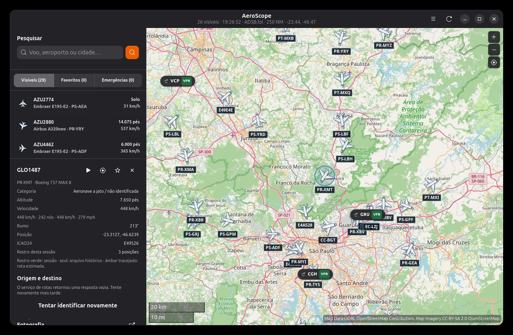
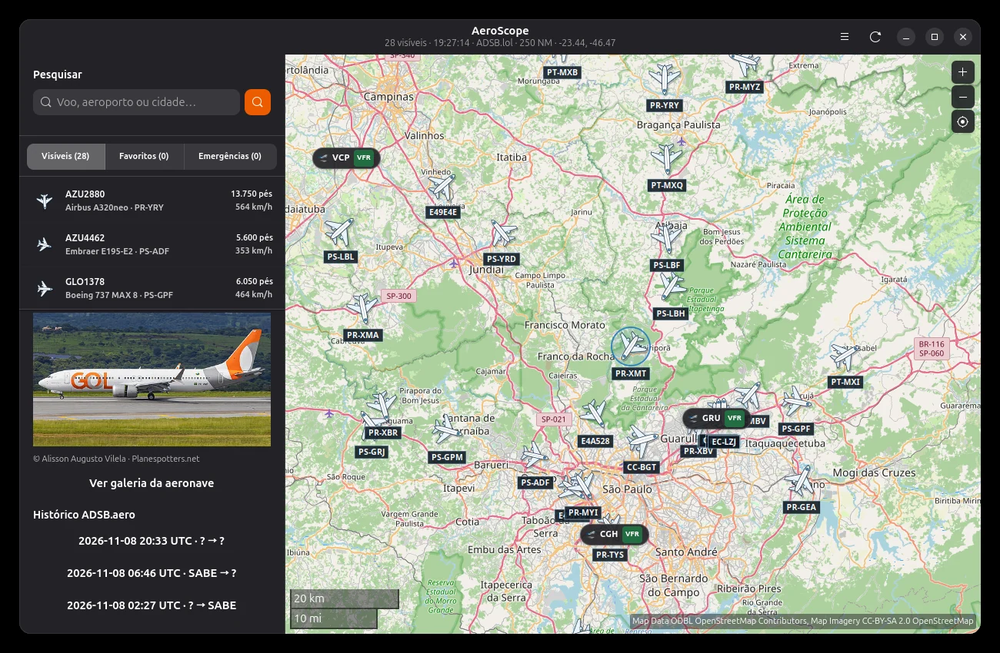
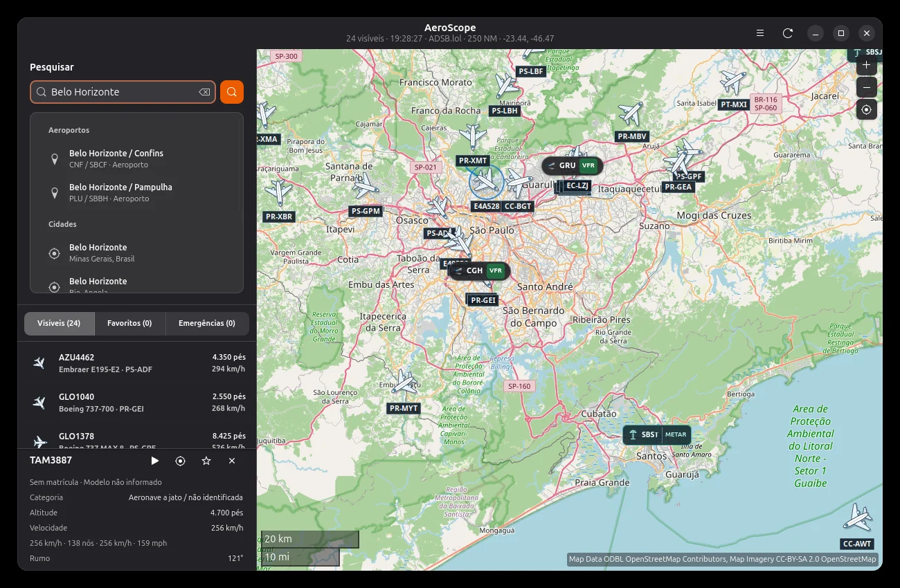
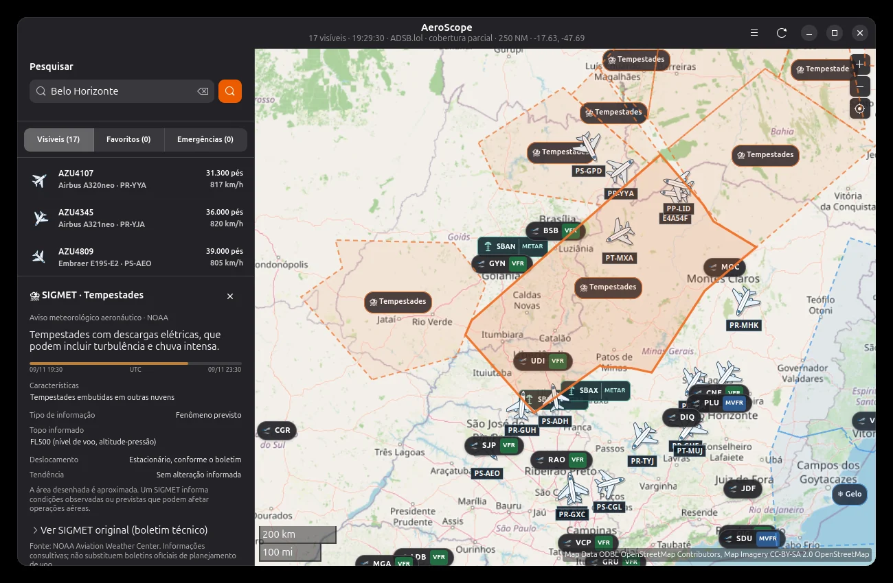
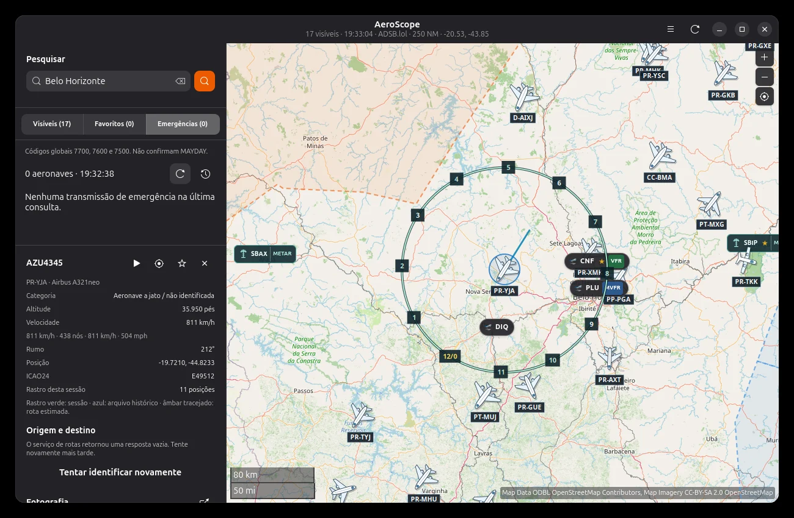
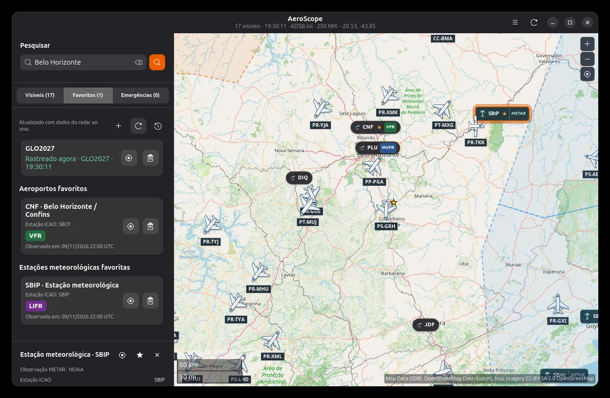
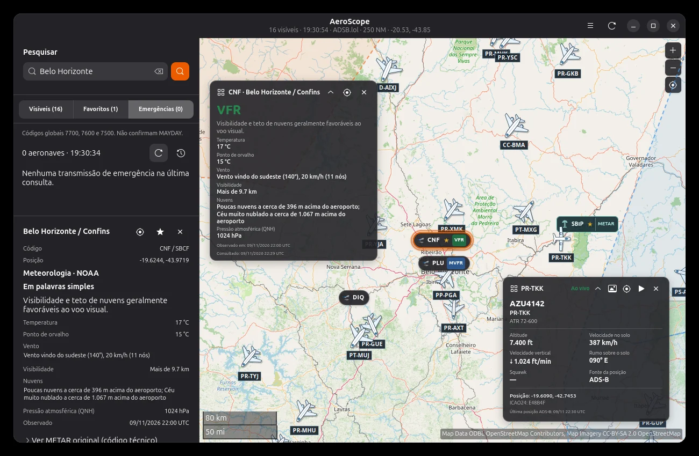
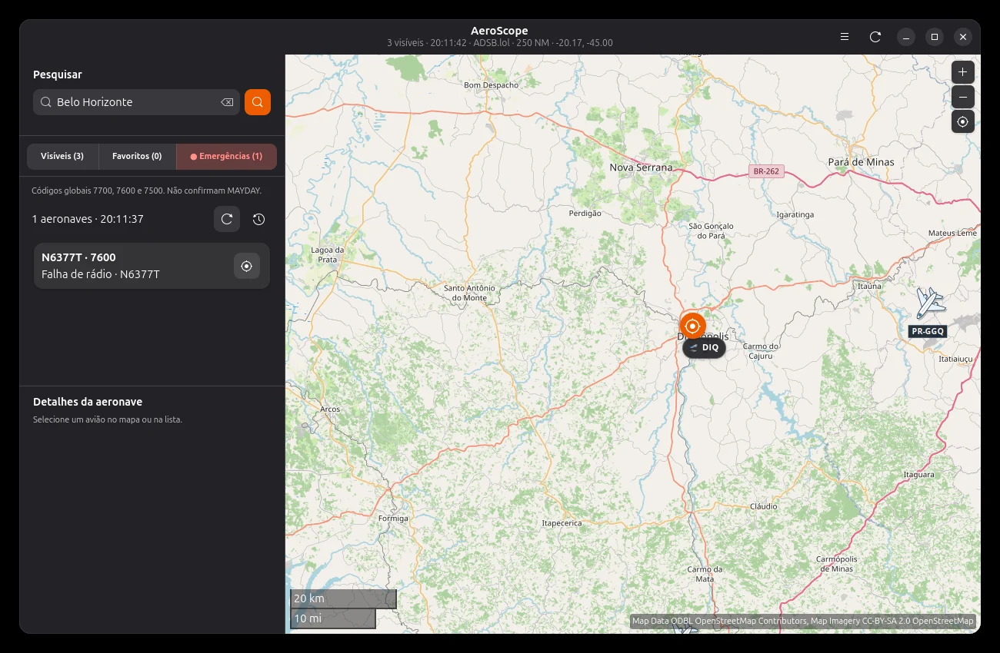
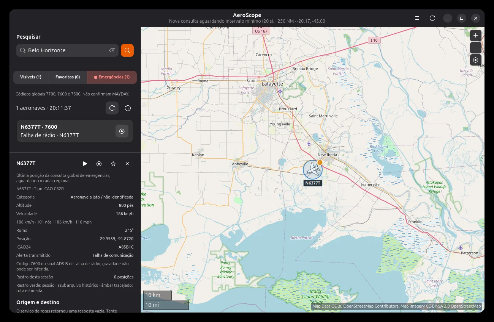

<div align="center">
  

  # AeroScope

  **The sky in motion, right on your Linux desktop.**

  A native GTK4/Libadwaita aircraft tracker with near-live flight data, aviation weather, historical playback and customizable monitoring.

  <p>
    
    
    
    
    <a href="LICENSE"></a>
  </p>

  **[English](README.en.md)** · **[Português (Brasil)](README.md)** · **[Install](#installation)** · **[Features](#features)** · **[Shortcuts](#keyboard-shortcuts)** · **[Contribute](CONTRIBUTING.md)**
</div>

<p align="center"><a href="media/screenshots/radar-aeronaves.webp"></a></p>

> [!NOTE]
> This documentation reflects **version 0.3.70**. The illustrated user manual will be published at an **external URL**, independently of app releases. No manual HTML is bundled with the original `.deb` or this GitHub source package.

## Why AeroScope?

AeroScope brings aviation data into a fast, familiar Linux desktop experience instead of another browser tab. Its core functionality uses public services without requiring user accounts or API credentials.

- Explore aircraft, airports and cities on interactive maps.
- Inspect flights, photos, aircraft details and observed paths.
- Replay archived trajectories with a timeline and graphs.
- Read METAR observations and SIGMET aviation advisories.
- Monitor favorite aircraft and worldwide emergency squawk codes.
- Customize the map, control-tower mode, widgets, PiP and theme.

## Screenshots

| Aircraft details | Historical flight replay |
|:--:|:--:|
| [](media/screenshots/detalhes-aeronave.webp) | [](media/screenshots/historico-replay.webp) |

| Aviation weather | Control-tower view |
|:--:|:--:|
| [](media/screenshots/meteorologia-sigmet.webp) | [](media/screenshots/torre-controle.webp) |

<details><summary><b>More screenshots: favorites, widgets and emergencies</b></summary>

| Favorites / METAR | Floating widgets |
|:--:|:--:|
| [](media/screenshots/favoritos-metar.webp) | [](media/screenshots/widgets-flutuantes.webp) |

| Global emergency list | Emergency details |
|:--:|:--:|
| [](media/screenshots/emergencias-lista.webp) | [](media/screenshots/emergencias-detalhes.webp) |

*Screenshots are snapshots, not live flight positions.*
</details>

## Features

### ✈️ Live aircraft tracking

AeroScope retrieves ADS-B network data from **ADSB.lol**. Select an aircraft in the list or on the map to examine its available identification, registration, type, altitude, speed, heading and position.

- Configurable polling with a **10-second minimum**.
- Regional lookups with a **250-nautical-mile query radius**, subject to provider limits.
- Optional smooth animation between received points: **no fabricated ADS-B fixes**.
- Session trail, hover highlighting, aircraft labels and map zoom/panning.
- Autocomplete for **aircraft, airports and cities**.

### 🧭 Routes and archived playback

When supported by the source, the sidebar can display **likely origin and destination** information and draw an **estimated geographical reference**. This is **not an official flight plan**. Historical flight records come from **ADSB.aero**, where available, with timeline-based playback and altitude/speed graphs. Coverage is incomplete and not guaranteed.

### 🌤️ METAR and SIGMET

The **NOAA Aviation Weather Center** provides regional observations and advisories. AeroScope can display METAR, flight categories such as VFR/MVFR/IFR/LIFR, SIGMET geometry and more readable explanations. Airports and weather stations can also be saved and monitored, with floating cards over the map.

### 🚨 Favorites and emergency monitoring

Watch **up to 12 favorite aircraft** by registration or ICAO24 address. Global monitoring checks emergency squawk codes independently from regional radar polling. Notifications and optional sounds are configurable.

| Squawk | Usual meaning |
|---|---|
| `7700` | General emergency |
| `7600` | Radio communication failure |
| `7500` | Unlawful interference |

**A detected squawk is not independent confirmation of an actual emergency.** Similarly, a missing signal does not prove an aircraft is grounded.

### 🖥️ Native Linux experience

Built with **GTK4/Libadwaita** and **Libshumate**, with automatic/light/dark themes, a visual control-tower sweep, PiP mini-map, full-screen dashboard, floating widgets and optional background operation. Window stacking and tray features vary by desktop environment.

AeroScope uses **GNU Gettext**. Source strings are in American English, with Brazilian Portuguese translations. The app follows your system language when supported; language changes in Preferences apply on restart.

## Installation

### Debian/Ubuntu package

Get a packaged build from **[GitHub Releases](https://github.com/ehstbr/Aeroscope/releases)** when published, then run:

```bash
sudo apt install ./aeroscope_0.3.70_all.deb
```

The installed command is **`aeroscope`** (not `aeroscope-gtk`). The exact release asset filename may vary.

### Run from source

On compatible Ubuntu/Debian systems:

```bash
sudo apt update
sudo apt install python3 python3-gi gir1.2-gtk-4.0 \
  gir1.2-adw-1 gir1.2-shumate-1.0
```

Optional in-app browser and location providers:

```bash
sudo apt install gir1.2-webkit-6.0 gir1.2-geoclue-2.0 geoclue-2.0
```

```bash
git clone https://github.com/ehstbr/Aeroscope.git
cd Aeroscope
./run.sh
```

Alternative startup: `python3 run.py`. Demo mode: `./run.sh --demo`.

### Build the `.deb` yourself

```bash
bash packaging/build-deb.sh "$PWD/aeroscope_0.3.70_all.deb"
```

Default output without an argument is the parent directory. Version values are defined in `packaging/build-deb.sh` and `aeroscope/settings.py`.

### Requirements

| Component | Requirement |
|---|---|
| OS | Graphical Linux desktop, optimized for Ubuntu/Debian |
| Python | **3.10+** |
| UI | **GTK4**, **Libadwaita**, **Libshumate**, PyGObject |
| Optional | WebKitGTK 6, GeoClue, tray/AppIndicator support |
| Internet | Required for live tracking, weather, maps and photos |
| Credentials | No API key required for the integrated public services |

Windows and macOS are not natively supported. Behavior may vary across GNOME, KDE Plasma, X11 and Wayland.

## Keyboard shortcuts

Application shortcuts use **Alt**, leaving system text-editing commands such as Ctrl+A/C/V untouched.

| Action | Shortcut | Action | Shortcut |
|---|---|---|---|
| Search | `Alt+F` | Locate | `Alt+.` or `Alt+L` |
| Zoom in/out | `Alt++` / `Alt+-` | Pan | `← ↑ → ↓` (map focused) |
| Control tower | `Alt+T` | Rotating sweep | `Alt+S` |
| METAR | `Alt+M` | SIGMET | `Alt+A` |
| Favorites | `Alt+B` | Emergencies | `Alt+E` |
| Visible aircraft | `Alt+V` | PiP mini-map | `Alt+P` |
| Preferences | `Alt+,` | Quit | `Alt+Q` |
| Shortcut help | `F1` | Full-screen dashboard | `F11` |
| Exit full screen | `Esc` | | |

See **F1** in the app for your installed version's reference.

## Providers and credits

| Source | What it provides |
|---|---|
| [ADSB.lol](https://www.adsb.lol/) | Live aircraft, registration/ICAO and squawk lookups, route associations |
| [ADSB.aero](https://adsb.aero/) | Archived tracks |
| [NOAA Aviation Weather Center](https://aviationweather.gov/) | METAR and SIGMET |
| [OpenStreetMap](https://www.openstreetmap.org/) | Map data and tiles |
| [openmaps.fr](https://openmaps.fr/) | Alternative map styles |
| [Planespotters.net](https://www.planespotters.net/) | Aircraft photography, with author credits |
| [Open-Meteo](https://open-meteo.com/) | City geocoding |
| [ipwho.is](https://ipwho.is/) | Approximate IP location, **only with consent** |
| [Flightradar24](https://www.flightradar24.com/) | External airport-page links; not the live tracking provider |

All provider quotas, map attribution requirements, licensing and image rights remain in effect. Please do not scrape or bulk-prefetch public map tile servers.

## Privacy and local storage

- No required AeroScope account or key for core tracking.
- GeoClue follows desktop permissions; IP-based geolocation requires explicit consent and exposes the public IP to the service.
- Preferences: `~/.config/aeroscope/settings.json` (or XDG equivalent).
- Saved favorites and persistent settings live in the local configuration directory.
- Session trails are memory-only, not certified flight records.
- Clearing AeroScope cache does not delete shared GNOME/Libshumate map caches.
- Network requests are made to the relevant service providers when enabled or requested.

## Developer guide

```text
AeroScope/
├── aeroscope/          # Python app
├── assets/             # Icon, desktop launcher and GTK styling
├── media/screenshots/  # README screenshots (excluded from Debian package)
├── po/                 # GNU Gettext catalogs
├── tests/              # Automated tests
├── benchmarks/         # Geometry benchmarks
├── packaging/          # Debian package builder
├── run.py / run.sh     # Development entry points
├── CHANGELOG.md        # Full version history
└── CONTRIBUTING.md     # Contribution guide
```

Run the automated suite:

```bash
python3 -m pip install pytest
python3 -m pytest -q
```

A graphical session is still necessary for manual GTK/Libadwaita checks. See **[CONTRIBUTING.md](CONTRIBUTING.md)** and **[CHANGELOG.md](CHANGELOG.md)** for details.

## FAQ

<details><summary><b>Why are some aircraft missing?</b></summary>ADS-B coverage, received transmissions, filtering and provider availability vary. Missing data does not prove a landing or a loss of transmission.</details>

<details><summary><b>Does smooth movement represent a new live measurement?</b></summary>No. Animation interpolates visually between received positions. It can be disabled in Preferences.</details>

<details><summary><b>Can the tower view be used operationally?</b></summary>No. The sweep and circles are for visual exploration only, not certified measurement or air traffic control.</details>

<details><summary><b>Why are route or photo details missing?</b></summary>These are optional external matches. AeroScope does not invent photos, flights or route endpoints.</details>

<details><summary><b>Will the manual require a new app version?</b></summary>No. The illustrated HTML manual is planned for an external URL and is not bundled in the original 0.3.70 package.</details>

## Important safety notice

> [!WARNING]
> AeroScope is **informational and recreational software**, **not** a certified aviation tool. Aircraft positions, animations, route associations, archived tracks and weather may be delayed, incomplete or incorrect. **Do not use it for flight planning, navigation, dispatch, air traffic control or safety-critical decisions.**

## License

AeroScope source code is released under the **[MIT License](LICENSE)**. Third-party maps, tiles, photographs and data retain their respective rights and terms.

Created by **Eduardo Henrique Teixeira** ([@ehstbr](https://github.com/ehstbr)), with an open-source spirit. Thanks to the open-data projects, volunteers and providers who make it possible. ✈️
