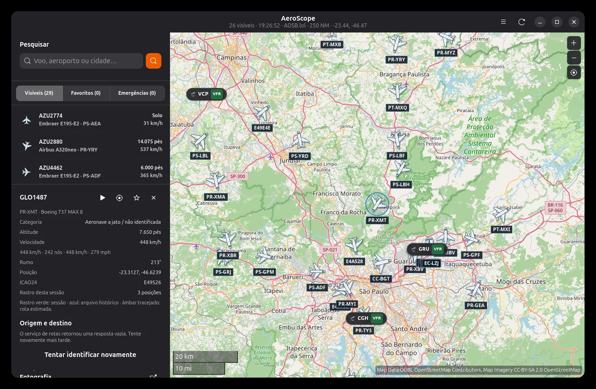
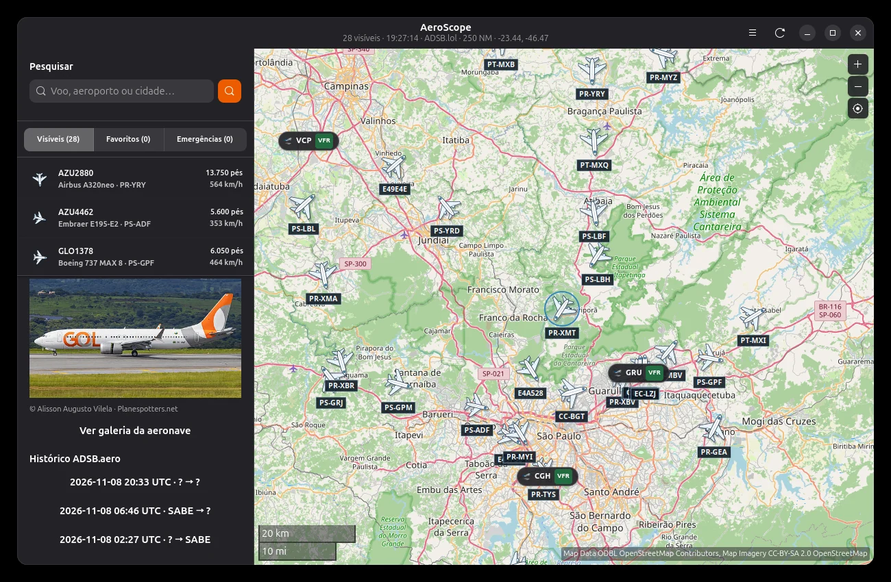
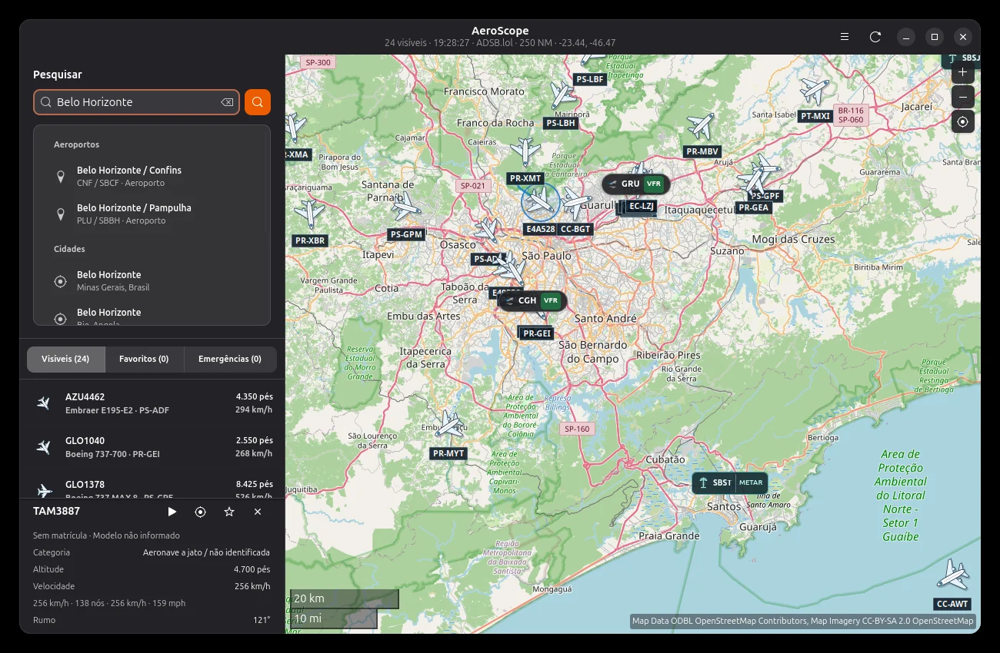
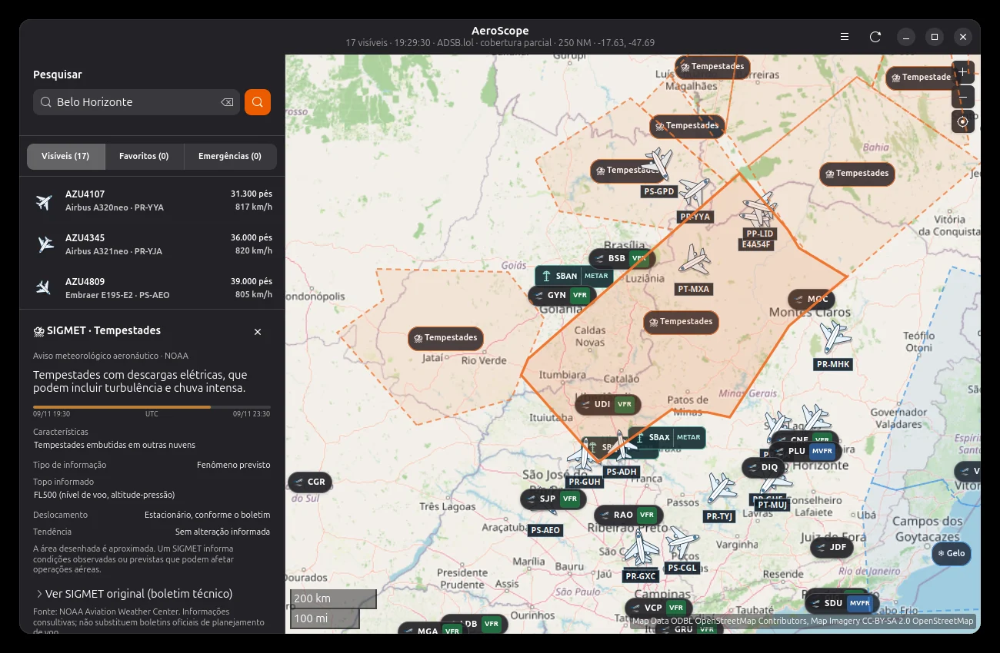
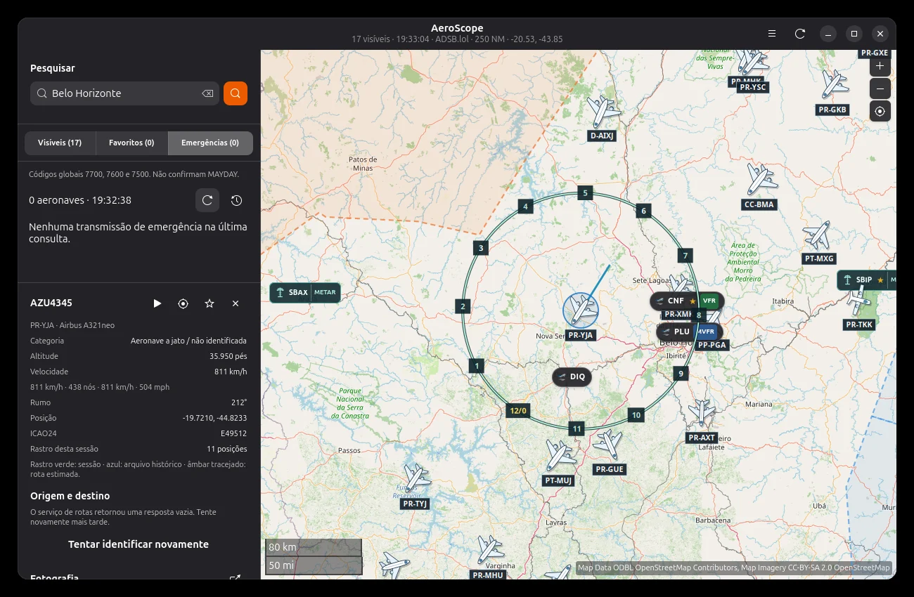
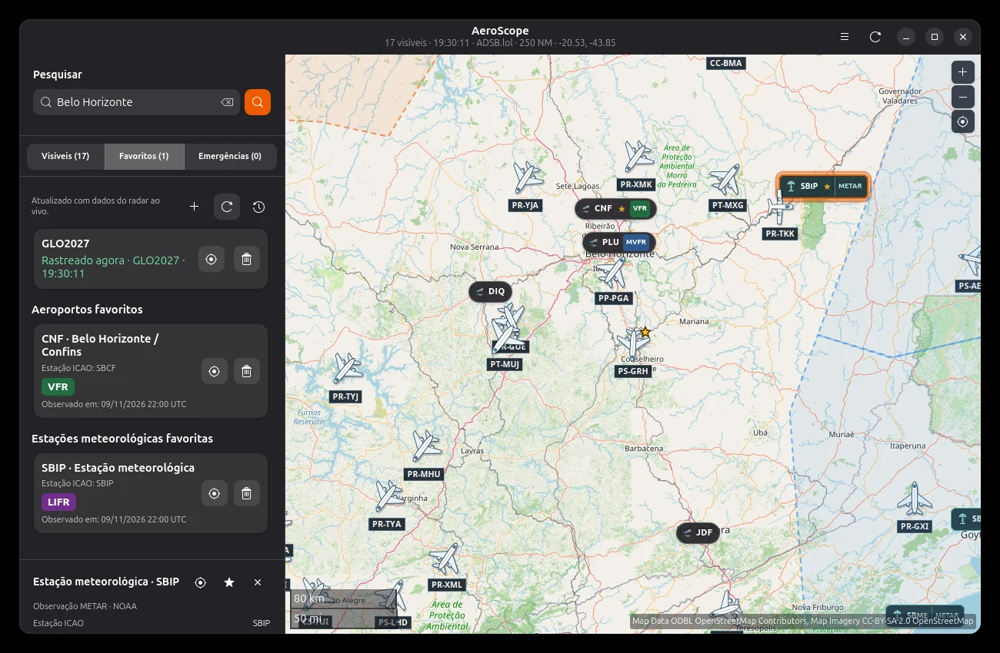
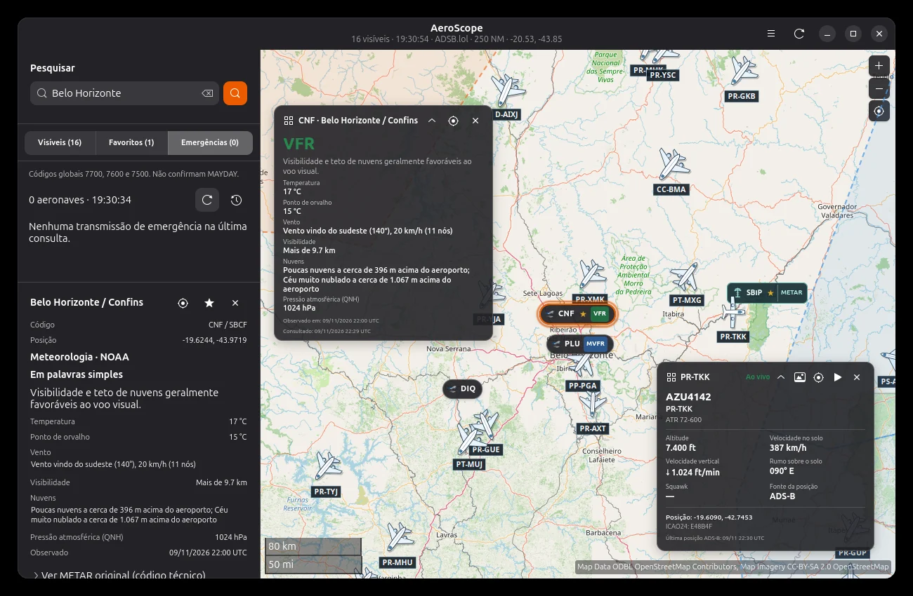
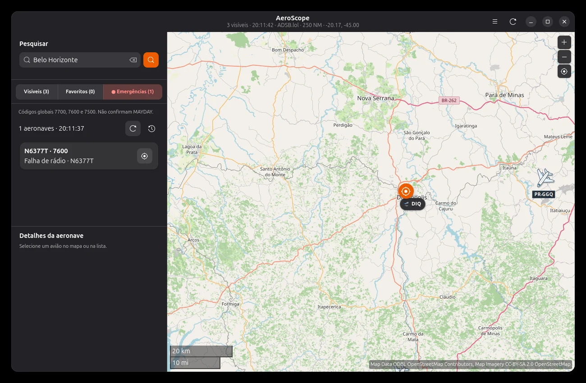
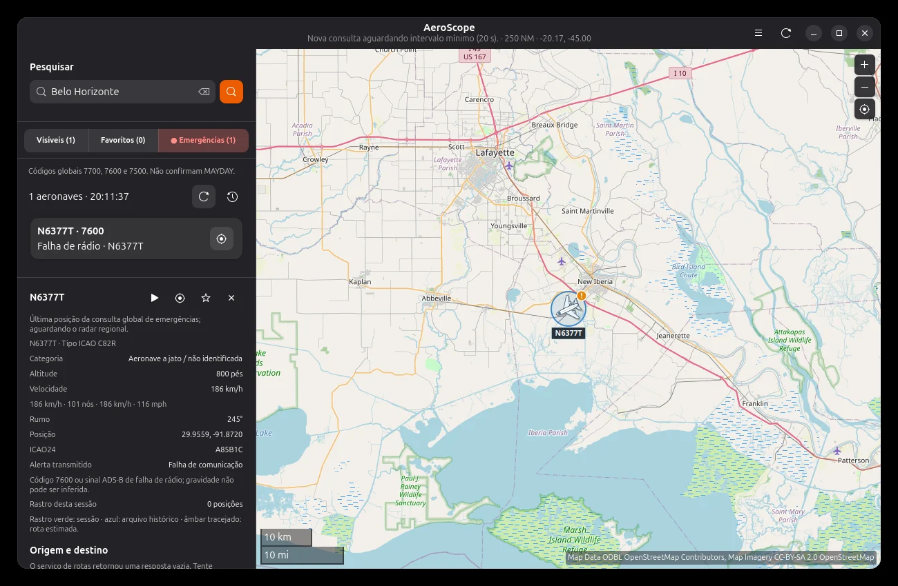

<div align="center">
  

  # AeroScope

  **O céu em movimento, direto no seu desktop Linux.**

  Radar de aeronaves em tempo quase real, meteorologia aeronáutica, histórico de voos e monitoramento de alertas — em uma interface nativa com GTK4 e Libadwaita.

  <p>
    
    
    
    
    <a href="LICENSE"></a>
  </p>

  **[Português](README.md)** · **[English](README.en.md)** · **[Instalação](#instalação)** · **[Funcionalidades](#o-que-você-pode-fazer)** · **[Atalhos](#atalhos-de-teclado)** · **[Contribuir](CONTRIBUTING.md)**
</div>

<p align="center">
  <a href="media/screenshots/radar-aeronaves.webp"></a>
</p>

> [!NOTE]
> **Projeto aberto e em evolução.** Esta documentação corresponde ao **AeroScope 0.3.70**. O manual ilustrado completo será disponibilizado em uma **URL externa**, independentemente das atualizações do aplicativo. Ele **não está incorporado** a este repositório nem ao pacote `.deb` original.

## Por que o AeroScope?

O AeroScope foi pensado para quem gosta de aviação e quer explorar o tráfego aéreo sem depender de uma aba do navegador. A proposta é combinar uma experiência **realmente nativa no Linux** com dados de fontes públicas, visualizações claras e controles práticos — sem contas obrigatórias ou chaves de API para as funções principais.

- **Explore** aeronaves, aeroportos e cidades em mapas interativos.
- **Acompanhe** aeronaves, fotos, dados transmitidos e rastros observados.
- **Reproduza** trajetórias arquivadas, com linha do tempo e gráficos.
- **Consulte** METAR e SIGMET, estações e condições meteorológicas.
- **Monitore** seus favoritos e códigos globais de emergência.
- **Personalize** mapa, modo torre, mini-mapa, widgets e aparência.

## Veja o aplicativo em ação

| Informações da aeronave | Histórico e reprodução |
|:--:|:--:|
| [](media/screenshots/detalhes-aeronave.webp) | [](media/screenshots/historico-replay.webp) |
| Dados, fotografia e identificação | Trajetória, cronologia e gráfico |

| Meteorologia aeronáutica | Modo torre de controle |
|:--:|:--:|
| [](media/screenshots/meteorologia-sigmet.webp) | [](media/screenshots/torre-controle.webp) |
| METAR, SIGMET e avisos na região | Círculos e varredura visual |

<details>
<summary><b>Mais capturas: favoritos, painel e emergências</b></summary>

| Favoritos e estações | Painéis flutuantes |
|:--:|:--:|
| [](media/screenshots/favoritos-metar.webp) | [](media/screenshots/widgets-flutuantes.webp) |

| Emergência 7600 — lista | Emergência 7600 — detalhes |
|:--:|:--:|
| [](media/screenshots/emergencias-lista.webp) | [](media/screenshots/emergencias-detalhes.webp) |

*Os prints representam momentos específicos de consulta e não dados atuais.*
</details>

## O que você pode fazer

### ✈️ Radar de aeronaves

O AeroScope consulta o **ADSB.lol** e mostra aeronaves transmitidas pela rede, com identificação, matrícula, tipo quando informado, altitude, velocidade, rumo e posição. É possível selecionar aeronaves diretamente no mapa ou na lista, visualizar dados complementares e acompanhá-las enquanto houver atualizações.

- Atualizações configuráveis, com intervalo mínimo de **10 segundos**.
- Consultas regionais com **raio de 250 milhas náuticas** por região consultada, respeitando limites do provedor.
- Movimento visual suavizado entre posições recebidas, **sem inventar novas posições ADS-B**.
- Rastro da sessão, identificação no mapa e destaque ao passar o ponteiro na lista.
- Zoom e deslocamento pelo mapa, incluindo movimentação suave pelas setas.
- Busca com sugestões de **aeronaves, aeroportos e cidades**.

### 🧭 Rastros, origem/destino e histórico

A partir de informações disponíveis nos serviços, o painel pode apresentar **origem e destino prováveis**. Quando houver associação válida, uma linha geográfica estimada pode servir como referência visual — **não representa um plano de voo oficial**.

O histórico usa dados arquivados do **ADSB.aero** quando disponíveis. É possível examinar trajetórias e reproduzi-las com controles de tempo, velocidades de reprodução e gráficos de altitude/velocidade. Nem todo voo ou intervalo possui registros arquivados.

### 🌤️ Meteorologia: METAR e SIGMET

Dados públicos do **NOAA Aviation Weather Center** permitem exibir observações METAR, categorias meteorológicas (como VFR, MVFR, IFR e LIFR) e áreas/avisos SIGMET. O aplicativo oferece textos mais acessíveis para interpretar boletins, preservando o dado técnico quando disponível.

Também é possível acompanhar aeroportos e estações salvos, consultar informações meteorológicas e posicionar cartões flutuantes sobre o mapa.

### 🚨 Monitoramento e emergências

O monitoramento de favoritos permite acompanhar **até 12 aeronaves** por matrícula ou ICAO24. Há consultas independentes para favoritos e para códigos de emergência, além de notificações configuráveis e aviso sonoro opcional.

| Código *squawk* | Significado habitual |
|---|---|
| `7700` | Emergência geral |
| `7600` | Falha de comunicação por rádio |
| `7500` | Interferência ilícita |

**Importante:** um código transmitido e captado pela rede não confirma, por si só, a natureza ou a gravidade de uma ocorrência. A ausência de aeronave na consulta também não comprova que ela pousou ou deixou de transmitir.

### 🖥️ Uma interface feita para o Linux

O aplicativo oferece interface **GTK4/Libadwaita**, seleção de tema claro/escuro/automático, **modo torre de controle** com varredura visual, mini-mapa em janela independente (*Picture-in-Picture*), modo painel em tela cheia, widgets reposicionáveis e opções de execução em segundo plano. O comportamento de bandeja e sobreposição de janelas depende do ambiente gráfico e de seus recursos.

A interface utiliza **GNU Gettext**: inglês dos EUA é o idioma original do código e português brasileiro está disponível por tradução. Por padrão, o AeroScope segue o idioma do sistema, quando compatível.

## Instalação

### Opção 1 — pacote Debian (.deb)

Para **Ubuntu e distribuições Debian-based compatíveis**, baixe o arquivo `.deb` publicado em **[Releases](https://github.com/ehstbr/Aeroscope/releases)** e instale com:

```bash
sudo apt install ./aeroscope_0.3.70_all.deb
```

> O nome exato do arquivo pode variar conforme o release. O pacote gerado pelo script deste projeto usa `aeroscope_0.3.70_all.deb` por padrão. O instalador instala o comando **`aeroscope`**, não `aeroscope-gtk`.

### Opção 2 — executar diretamente do código-fonte

Instale as dependências básicas em Ubuntu/Debian:

```bash
sudo apt update
sudo apt install python3 python3-gi gir1.2-gtk-4.0 \
  gir1.2-adw-1 gir1.2-shumate-1.0
```

Dependências opcionais (navegador interno e localização):

```bash
sudo apt install gir1.2-webkit-6.0 gir1.2-geoclue-2.0 geoclue-2.0
```

Clone o repositório e execute:

```bash
git clone https://github.com/ehstbr/Aeroscope.git
cd Aeroscope
./run.sh
```

Também é possível iniciar por `python3 run.py` ou experimentar o modo de demonstração com `./run.sh --demo`.

<details>
<summary><b>Como gerar seu próprio instalador .deb</b></summary>

Requer `dpkg-deb` e o ambiente de empacotamento do Debian:

```bash
bash packaging/build-deb.sh
```

Por padrão, o pacote é criado **na pasta acima** do repositório. Também é possível escolher o arquivo de saída:

```bash
bash packaging/build-deb.sh "$PWD/aeroscope_0.3.70_all.deb"
```

A versão está definida no script de empacotamento e em `aeroscope/settings.py`; revise ambos ao fazer um novo release.
</details>

### Requisitos e compatibilidade

| Item | Observação |
|---|---|
| Sistema | Linux com desktop gráfico compatível; foco em Ubuntu/Debian |
| Python | **3.10 ou superior** |
| Interface | **GTK4**, **Libadwaita**, **Libshumate** e PyGObject |
| Conectividade | Necessária para dados ao vivo, clima, fotos e tiles de mapas |
| Opcionais | WebKitGTK 6, GeoClue, suporte a bandeja/AppIndicator |
| API key | Não exigida para os serviços públicos integrados nesta versão |

O AeroScope não é um aplicativo nativo para Windows ou macOS. Recursos específicos de janelas variam entre GNOME, KDE Plasma, X11 e Wayland.

## Atalhos de teclado

Os atalhos do aplicativo utilizam **Alt**. Os atalhos comuns de edição, como **Ctrl+A**, **Ctrl+C** e **Ctrl+V**, permanecem reservados aos campos de texto.

| Função | Atalho | Função | Atalho |
|---|---|---|---|
| Buscar | `Alt+F` | Centralizar localização | `Alt+.` ou `Alt+L` |
| Aproximar | `Alt++` | Afastar | `Alt+-` |
| Modo torre | `Alt+T` | Varredura giratória | `Alt+S` |
| Observações METAR | `Alt+M` | Avisos SIGMET | `Alt+A` |
| Favoritos | `Alt+B` | Emergências | `Alt+E` |
| Aeronaves visíveis | `Alt+V` | Mini-mapa/PiP | `Alt+P` |
| Preferências | `Alt+,` | Sair | `Alt+Q` |
| Lista de atalhos | `F1` | Painel em tela cheia | `F11` |
| Sair da tela cheia | `Esc` | Mover o mapa | `←` `↑` `→` `↓` (com foco no mapa) |

Algumas combinações podem depender do layout de teclado. A própria janela **F1** apresenta os atalhos da versão instalada.

## Serviços e fontes de dados

O AeroScope é um **cliente independente** desses serviços. A disponibilidade e os limites de uso são definidos pelos respectivos provedores.

| Provedor | Finalidade |
|---|---|
| [ADSB.lol](https://www.adsb.lol/) | Aeronaves ao vivo, filtros de favoritos/emergências e associação provável de rotas |
| [ADSB.aero](https://adsb.aero/) | Histórico de trajetórias, quando disponível |
| [NOAA Aviation Weather Center](https://aviationweather.gov/) | METAR e SIGMET |
| [OpenStreetMap](https://www.openstreetmap.org/) | Base cartográfica e atribuições |
| [openmaps.fr](https://openmaps.fr/) | Estilos topográficos/alternativos disponibilizados pelo provedor |
| [Planespotters.net](https://www.planespotters.net/) | Fotografias, quando fornecidas, com créditos e links de origem |
| [Open-Meteo Geocoding](https://open-meteo.com/) | Pesquisa de cidades |
| [ipwho.is](https://ipwho.is/) | Localização aproximada por IP, **somente mediante consentimento** |
| [Flightradar24](https://www.flightradar24.com/) | Link externo para informações públicas de aeroportos; não é fonte do radar ao vivo |

**Créditos e licenças dos mapas:** as atribuições dos provedores aparecem na interface. Respeite as políticas dos servidores de tiles; não faça coleta massiva, pré-carregamento de áreas ou redistribuição de imagens sem autorização. Fotografias continuam sujeitas aos direitos de seus autores e provedores.

## Privacidade, permissões e arquivos locais

- **Sem conta obrigatória:** os recursos principais não exigem cadastro ou token do usuário.
- **Localização:** GeoClue utiliza permissões do ambiente; localização por IP exige aceitação explícita, pode ser imprecisa e compartilha o IP público com o provedor consultado.
- **Preferências:** `~/.config/aeroscope/settings.json` (ou caminho XDG equivalente).
- **Favoritos e outras escolhas persistentes:** ficam em arquivos locais da configuração do aplicativo.
- **Rastros da sessão:** permanecem em memória e podem ser limpos; não são um registro aeronáutico oficial.
- **Cache:** o AeroScope não exclui o cache compartilhado de mapas de outros aplicativos ao limpar seus próprios dados.
- **Internet:** o aplicativo consulta os serviços listados acima quando os respectivos recursos estão ativos ou são solicitados.

## Desenvolvimento e colaboração

O núcleo é escrito em **Python**, com UI nativa GTK4/Libadwaita, mapas via Libshumate e tradução GNU Gettext. Os módulos de dados, meteorologia, monitoramento, desenho e interface têm testes automatizados.

```text
AeroScope/
├── aeroscope/       # Código do aplicativo
├── assets/          # Ícone, arquivo .desktop e estilos GTK
├── media/screenshots/ # Imagens do README (não entram no DEB)
├── po/              # Traduções e modelo Gettext
├── tests/           # Testes automatizados
├── benchmarks/      # Benchmarks de geometria
├── packaging/       # Gerador de .deb
├── run.py / run.sh  # Inicialização pelo código-fonte
├── CHANGELOG.md     # Histórico completo até 0.3.70
└── CONTRIBUTING.md  # Como contribuir
```

### Rodar os testes

```bash
python3 -m pip install pytest
python3 -m pytest -q
```

A interface visual também deve ser validada em uma sessão Linux real, especialmente com GNOME/Wayland, outros desktops e diferentes escalas de tela. Para contribuir com código, traduções e relatórios de erros, veja **[CONTRIBUTING.md](CONTRIBUTING.md)**. O histórico técnico detalhado está em **[CHANGELOG.md](CHANGELOG.md)**.

## Perguntas frequentes

<details>
<summary><b>Por que nem todos os aviões aparecem?</b></summary>

A cobertura depende das estações receptoras, do tipo de transmissão, dos filtros e da disponibilidade da rede. Uma aeronave ausente da consulta não deve ser considerada automaticamente em solo ou fora de operação.
</details>

<details>
<summary><b>O avião está se movendo mesmo sem uma posição nova?</b></summary>

O movimento entre consultas é uma animação visual baseada nas últimas posições observadas. O AeroScope não afirma conhecer a posição exata entre mensagens recebidas. Você pode desativar a animação nas Preferências.
</details>

<details>
<summary><b>Posso usar o modo torre como radar operacional?</b></summary>

Não. A grade e a varredura são **representações visuais**, sem finalidade de controle de tráfego ou medição certificada.
</details>

<details>
<summary><b>Por que a fotografia ou a origem/destino estão vazios?</b></summary>

São informações complementares e dependem de correspondências nos provedores. O aplicativo não cria fotografia nem inventa rota quando não existe resposta válida.
</details>

<details>
<summary><b>O manual pode ser atualizado sem atualizar o programa?</b></summary>

Sim. O plano do projeto é hospedar o **manual HTML em endereço externo**. Ele não faz parte do DEB da versão 0.3.70, e a URL poderá ser associada a uma opção de menu em uma versão futura.
</details>

## Uso responsável

> [!WARNING]
> O AeroScope é uma ferramenta **informativa e recreativa**. Dados ADS-B, estimativas de rota, posições animadas, histórico e boletins meteorológicos podem estar incompletos ou atrasados. **Não use o AeroScope para navegação aérea, operação de aeronaves, despacho, controle de tráfego ou decisões de segurança de voo.**

## Licença e agradecimentos

O código deste repositório é distribuído sob a **[licença MIT](LICENSE)**. Isso **não** altera os direitos sobre mapas, tiles, fotografias ou dados disponibilizados por terceiros, que seguem suas próprias condições.

Criado por **Eduardo Henrique Teixeira** ([@ehstbr](https://github.com/ehstbr)), com espírito de software livre. Obrigado aos projetos de dados abertos, aos provedores de mapas e à comunidade que torna o céu mais acessível. ✈️

<div align="center">
  <sub>AeroScope • 0.3.70 • Linux • GTK4 / Libadwaita</sub>
</div>
